# Ritm AI — Texnik topshiriq (TZ)

| | |
|---|---|
| **Loyiha** | Ritm AI (`@ritm_airobot`) |
| **Hujjat turi** | Texnik topshiriq: tizim dizayni, talablar, ish jarayonlari |
| **Kod asosi** | `main` filiali, commit `afa8f9f` (Alembic head `0035`) |
| **Sana** | 24.11.2026 |
| **Holat belgilari** | **Bor** — kodda ishlaydi · **Qisman** — bir qismi bor yoki faqat bitta yuzada · **Rejada** — kodda yo‘q, faqat rejada |

> Hujjat faqat kodda ko‘ringan narsani “Bor” deb yozadi. Kodda yo‘q narsalar “Rejada” deb belgilangan va manbasi (split-plan rejasi, E/F fazalar) ko‘rsatilgan. Maxfiy kalitlar va muhit qiymatlari keltirilmagan, faqat o‘zgaruvchi nomlari bor.

---

## 1. Loyiha maqsadi va auditoriya

**Maqsad.** Ritm — Telegram orqali ishlaydigan bizneslar va hamjamiyatlar uchun ko‘p ijarachili (multi-tenant) platforma. Uchta yuzasi bor:

1. **Telegram bot** — onboarding, eslatmalar, e’lonlar, kvizlar, to‘lov cheklari, panelga kirish havolasi.
2. **Mini App** (Telegram ichidagi veb-ilova) — rolga qarab: o‘quvchi ilovasi, o‘qituvchining “Ta’lim” kabineti, kanal/chat egasining “Hamjamiyat” bo‘limi, super admin.
3. **O‘qituvchi veb-paneli** (`/panel`) — brauzerda keng ekranli ish joyi, bir martalik havola orqali kirish.

**Birinchi yo‘nalish (vertical):** onlayn ta’lim — repetitor/o‘qituvchi va uning o‘quvchilari (“Ta’lim”). Ma’lumotlar modeli yo‘nalishga bog‘lanmagan: har bir egasi uchun `workspaces.vertical` (hozir faqat `tutor`), frontendda `vertical.js` “paket” sifatida yorliqlar va tablarni beradi. Keyinchalik boshqa sohalar shu qobiqqa qo‘shiladi.

**Ikkinchi yo‘nalish (hamjamiyat):** Telegram kanal va guruhlar egalari uchun AI kontent, kvizlar, reyting — auditoriyani faol ushlab turish.

**Auditoriya:**

| Kim | Ehtiyoji |
|---|---|
| O‘qituvchi / repetitor | Guruh, jadval, davomat, kurs to‘lovlari, eslatmalar, hisobot — bitta joyda |
| O‘quvchi (yoki ota-ona) | Keyingi dars, darsga kirish havolasi, davomat, to‘lov holati, baho va vazifa |
| Kanal/guruh egasi va adminlari | Kunlik post, kviz, reyting, statistika |
| Platforma egasi (super admin) | Mijozlar, tarif to‘lovlarini tekshirish, audit, tizim holati |

---

## 2. Rollar va ruxsatlar (RBAC)

### 2.1. Rol qanday aniqlanadi

Rollar bazada alohida ustun sifatida **saqlanmaydi**, har so‘rovda ma’lumotdan hisoblanadi:

| Rol | Manba (kod) | Shart |
|---|---|---|
| `super_admin` | `SUPER_ADMIN_IDS` muhit o‘zgaruvchisi | Telegram ID ro‘yxatda |
| `owner` (chat egasi) | `member_view.resolve_roles` → `panel.managed` | `chats.owner_id` = foydalanuvchi |
| `admin` (chat admini) | Telegram `getChatAdministrators` (qisqa kesh, xatoda “admin emas”) | Ulangan chatda administrator, lekin egasi emas |
| `member` | `member_chats` | Faol ulangan chatda kamida bitta kvizga javob bergan |
| O‘qituvchi | `RoleService.for_user` → `modes.teaching` | `workspaces` yozuvi bor va unda kamida 1 guruh yoki 1 o‘quvchi (`panel_login.is_teacher`) |
| O‘quvchi | `modes.learning` / `modes.pending` | `tutor_students.telegram_id` bog‘langan va guruhda `active` (yoki `pending` — so‘rov kutilmoqda) |
| Oddiy foydalanuvchi | — | Yuqoridagilarning hech biri |

Bitta Telegram hisobida bir nechta rol bo‘lishi mumkin (masalan, o‘qituvchi + o‘quvchi + kanal egasi).

### 2.2. Mini App’da avtomatik yo‘naltirish (`roles.js`)

- Faqat o‘qituvchi → “Ta’lim” kabineti (`#/cabinet`).
- Faqat o‘quvchi → o‘quvchi ilovasi (`#/study`).
- Ikkala rol → oxirgi tanlov `localStorage` dagi **`ritm.role`** kalitidan olinadi; sukut — o‘qituvchi.
- Bir martalik ishora: `startapp=cabinet`, `?role=teacher|student`, `#role=…` yoki `start_param` — `ritm.role` ga yoziladi, tugma chizilmaydi.
- Bosh sahifadagi rol tugmalari olib tashlangan; almashtirish Profil / panel avatar menyusida (“O‘quvchi ilovasiga o‘tish”).

**Pastki tablar (`vertical.js`):** o‘qituvchi — `cabinet` (yorlig‘i “Ta’lim”), chat egasi bo‘lsa qo‘shimcha `home`, `chats` (“Hamjamiyat”); o‘quvchi — `study`, `agenda`, `profile`; reyting/tarix — Profil ichidan.

### 2.3. Chat ruxsat matritsasi (`panel.permits`)

| Rol | VIEW (ko‘rish) | ACT (hozir post/kviz/reyting) | EDIT (sozlama) | BOARD (reyting) |
|---|:-:|:-:|:-:|:-:|
| super_admin | ✓ | ✓ | ✓ | ✓ |
| owner | ✓ | ✓ | ✓ | ✓ |
| admin | ✓ | ✓ | faqat `chats.admins_can_edit = true` bo‘lsa | ✓ |
| member | — | — | — | ✓ |

### 2.4. Kim nima qila oladi

| Imkoniyat | Super admin | Chat egasi / admin | O‘qituvchi | O‘quvchi | Oddiy foydalanuvchi |
|---|---|---|---|---|---|
| **Bot** | Tarif to‘lovlarini tasdiqlash/rad etish/soxta deb belgilash, tarif berish, bloklash, 🩺 tizim holati, kunlik zaxira nusxa | Chat ulash, profil (soha, ton, til), kunlik post va kviz jadvali, reyting, sinov hisoboti, tarif sotib olish | `/panel` havolasi; so‘rov kartasi (botning o‘zida tasdiqlash/rad etish); davomat kartasi (botda belgilash); eslatmalar | `join_`/`enroll_` havola bilan qo‘shilish, eslatma va e’lonlar, “O‘qishim” xulosasi, vazifa eslatmasi | `/start`, til, kabinetni yoqish yoki kod bilan qo‘shilish |
| **Mini App** | `#/admin`: umumiy ko‘rsatkich, mijozlar, to‘lovlar, chatlar, audit, grafiklar | `#/home`, `#/chats`: chat sozlamalari, hozir post/kviz, statistika | “Ta’lim” kabineti: guruh, jadval, davomat, o‘quvchi, to‘lov, eslatma, hisobot | `#/study`, `#/agenda`, Profil: dars, davomat, to‘lov, baho, vazifa (faqat ko‘rish) | Kod kiritish, kabinetni yoqish |
| **Veb-panel** | — (alohida admin sahifasi yo‘q) | — | Bosh, Jadval, Guruhlar, O‘quvchilar, Davomat, To‘lovlar, Hisobotlar, Sozlamalar | “O‘quvchi ilovasiga o‘tish” havolasi (ikkala rol bo‘lsa) | “Siz o‘qituvchi emassiz” sahifasi |

Barcha `/api/tutor/*` so‘rovlari **egasiga cheklangan** (`owner_id` bo‘yicha), boshqa o‘qituvchining ma’lumoti ko‘rinmaydi. Muayyan begona yozuvga murojaat 404 bilan rad etiladi; ro‘yxatlar esa begona yozuvlarni qaytarmaydi. 52 ta endpoint uchun egalararo HTTP test matritsasi mavjud.

---

## 3. Funksional talablar (modullar bo‘yicha)

| # | Modul | Talab | Holat | Izoh / kod |
|---|---|---|---|---|
| 3.1 | **Kabinet (workspace)** | O‘qituvchi kabinetini yoqish, nom, o‘qituvchi ismi | Bor | `/api/tutor/enable`, `/api/tutor/name`; `workspaces` (egasi+vertical bo‘yicha bitta) |
| 3.2 | **Guruhlar** | Yaratish/tahrirlash/o‘chirish; hafta kunlari, boshlanish–tugash vaqti, daraja | Bor | `groups.py`; panelda o‘chirish yo‘q — faqat Mini App’da |
| | | O‘quvchini guruhga qo‘shish/chiqarish | Bor | `/groups/{id}/students` |
| | | Guruhni Telegram chatga bog‘lash | Qisman | API bor (`/groups/{id}/chat`), panelda yo‘q — Mini App’da |
| | | Ro‘yxatdan o‘tish havolasi (`enroll_code`) | Bor | `t.me/<bot>?start=enroll_<kod>` va guruh chatidagi tugma |
| 3.3 | **O‘quvchilar** | Karta: ism, telefon, holat (`paid/debtor/inactive/pending`), boshlang‘ich qarz, izoh | Bor | `students.py` |
| | | Shaxsiy taklif havolasi (`join_code`) | Bor | `start=join_<kod>`, Mini App’da `/api/me/join` |
| | | Ro‘yxatdan o‘tish so‘rovlarini tasdiqlash/rad etish | Bor | `/api/tutor/requests/*`, panel Bosh va O‘quvchilar |
| | | O‘quvchini o‘chirish | Qisman | API bor, panelda yo‘q — Mini App’da |
| 3.4 | **Jadval / sessiyalar** | Guruh slotidan 14 kun oldinga sessiyalar avtomatik yaratiladi | Bor | `sessions.py` (`HORIZON_DAYS = 14`), tick’da `refill_sessions` |
| | | Dars holati: rejalashtirilgan / o‘tdi / bekor; vaqtni ko‘chirish | Bor | Bekor va ko‘chirishda o‘quvchilarga xabar |
| | | Onlayn dars havolasi (`meeting_url`, faqat http/https) | Bor | “Darsga kirish” tugmasi |
| | | Yakka (shaxsiy) dars qo‘shish | Qisman | API (`/api/tutor/lessons`) bor, panelda yo‘q |
| 3.5 | **Davomat** | Sessiya bo‘yicha belgilash: keldi / kelmadi / kechikdi / sababli | Bor | `tutor_attendance` |
| | | Oylik davomat jadvali, foiz | Bor | `/groups/{id}/attendance` |
| | | Belgilanmagan davomat haqida o‘qituvchiga xabar | Bor | `notify_attendance.py` |
| | | O‘quvchi o‘z davomatini ko‘radi | Bor | `/api/me/attendance` |
| 3.6 | **Kurs to‘lovlari** | To‘lov qoidasi: `none` / `monthly` / `package` (N dars), summa, hisob kuni (1–28), to‘lash muddati (0–31 kun) | Bor | `fees.py`, `fee_rules.py` |
| | | O‘quvchiga alohida narx (`fee_override_uzs`) | Bor | `/groups/{id}/members/{sid}/fee` |
| | | Hisob-fakturalar kuniga bir marta (Toshkent vaqti) ochiladi, muddati o‘tganlari `overdue` | Bor | `jobs/tutor_fees.py` |
| | | Paket: “keldi” va “kechikdi” belgilari paketdan dars sarflaydi | Bor | `fee_usage.py` |
| | | To‘lov qayd qilish (qisman ham), bekor qilish, kechirish (`waived`); usul: naqd/karta/o‘tkazma/boshqa | Bor | `fee_pay.py`; ortiqcha to‘lov rad etiladi. **Free** tarifda faqat ko‘rish |
| | | Qarzlar: shu oy, jami, kartadagi boshlang‘ich qarz alohida | Bor | `fees/summary` |
| | | O‘quvchi o‘z hisoblarini ko‘radi | Bor | `/api/me/fees` |
| | | O‘quvchi kurs to‘lovi chekini botga yuborishi | Rejada | split-plan rejasi |
| 3.7 | **Eslatmalar** | Dars oldidan avtomatik (15/30/60/120 daqiqa) | Bor | `remind_lesson_min` |
| | | To‘lov muddatidan oldin (1/3/7 kun) va kechikkanda | Bor | `fee_due`, `fee_overdue` |
| | | Vazifa muddatidan bir kun oldin kechqurun | Bor | `notify_homework.py` |
| | | Qo‘lda eslatma: o‘ziga / o‘quvchiga / guruhga, belgilangan vaqtda | Bor | `tutor_reminders` |
| | | Tinch soatlar 22:00–08:00 (Toshkent) — ertalab 08:00 ga suriladi | Bor | `notify_rules.quiet_wake` |
| | | Oylik xabar kvotasi tarifga bog‘liq | Bor | `max_tutor_notifications_month` |
| | | Har bir hodisa bir marta yuboriladi | Bor | `tutor_notifications` unikal kaliti |
| | | O‘quvchi o‘zi eslatmalarni sozlashi (Profil) | Rejada | split-plan, B fazasi davomi |
| 3.8 | **E’lonlar** | Guruh o‘quvchilariga va bog‘langan chatga e’lon | Bor | `/groups/{id}/announce` |
| | | To‘lov eslatmasini guruh chatida ham chiqarish (`fee_in_group`) | Bor | guruh sozlamasi |
| 3.9 | **Mavzu, baho, vazifa** | Mavzu (sana bilan), 0–10 baho, guruh reytingi | Bor | `grades.py`, `tutor_topics`, `tutor_scores` |
| | | Vazifa matni (≤1000 belgi) va muddati | Bor | `homework.py`; panelda yo‘q — Mini App’da |
| | | O‘quvchi vazifani ko‘radi | Bor | faqat ko‘rish |
| | | **Vazifa topshirish va baholash** | Rejada | F fazasi |
| | | **Darsdan keyin 1–5 baho** | Rejada | E fazasi |
| 3.10 | **Hisobotlar** | Oylik hisobot: davomat, to‘lovlar, a’zolik o‘zgarishlari | Bor | `month_report.py`, Pro/Ultra |
| | | CSV eksport (o‘quvchilar, to‘lovlar, davomat), Excel uchun BOM | Bor | `csv_export.py`, Pro/Ultra |
| | | Panel Bosh: bugungi darslar, belgilanmagan davomat, kechikkan to‘lov, so‘rovlar, shu oy tushum | Bor | `panel_home.py` |
| 3.11 | **Chatlar / Hamjamiyat** | Bot kanal/guruhga qo‘shilganda ulash (tasdiq bilan) | Bor | `connect.py`, `lifecycle.py` |
| | | Chat profili: soha, tavsif, til, ton, daraja, vaqt zonasi, taqiqlangan mavzular | Bor | `chat_profiles` |
| | | Haftalik Top-10 reyting, “Hozir e’lon qilish” | Bor | `leaderboard_*`, Pro/Ultra/sinov |
| | | Statistika va grafiklar | Bor | `/api/stats`, `/api/charts` |
| | | Chat ulashni veb-paneldan qilish | Rejada | G fazasi |
| 3.12 | **AI funksiyalar** | Chat profili asosida kunlik post | Bor | `generate.py`; provayder Gemini (sukut) yoki OpenAI |
| | | Javoblar keshi va oylik AI kvotasi | Bor | `ai_cache`, `usage_counters` |
| | | Ta’lim kabinetida AI (mavzu, vazifa yaratish va h.k.) | Rejada | kodda yo‘q |
| 3.13 | **Kvizlar** | Chop etilgan postlardan kviz: kanalda shaxsiy deep-link, guruhda native poll | Bor | `quizgen.py`, `quiz_publish.py` |
| | | Admin postidan kechiktirilgan avtomatik kviz (≥200 belgi, 600 s) | Bor | `admin_posts.py`, Pro/Ultra/sinov |
| | | To‘g‘ri javob uchun ball (sukut 10) | Bor | `quiz_answers`, `leaderboard_entries` |
| 3.14 | **Tariflar va limitlar** | Free / Start / Pro / Ultra; sinov davri (Pro darajasida) | Bor | `plans`, `access.py`, `trial.py` |
| | | Tarifni qo‘lda karta o‘tkazmasi bilan sotib olish, super admin tekshiruvi | Bor | `payments.py`, `docs/payments-trust.md` |
| | | Asoschi narxi (birinchi 20 to‘lovchi, −30%), davr chegirmasi (3 oy −7%, 12 oy −15%) | Bor | `pricing.py` |
| | | Sinov hisobotlari va muddat tugashi xabari | Bor | `trial_reports.py`, `trial_nudge.py` |
| | | Tarif sotib olish veb-paneldan | Rejada | hozir bot va Mini App’da |
| | | Avtomatik to‘lov tizimlari (Click/Payme va h.k.) | Rejada | kodda faqat `manual_card` |
| 3.15 | **Panelga kirish** | `/panel` buyrug‘i yoki Mini App tugmasi → bir martalik havola → cookie sessiya | Bor | `panel_login.py`, `panel_auth.py` |
| | | Telegram Login Widget (zaxira kirish yo‘li) | Rejada | split-plan, 8-bo‘lim |
| 3.16 | **Vidjetlar** | Shaxsiy chatda interaktiv kartalar: o‘quvchiga dars/vazifa va to‘lov; o‘qituvchiga so‘rov (tasdiqlash), davomat (belgilash), oylik hisobot, tarif holati | Bor | `widget_cards.py`, `widget_queries.py`, `tutor_widget_messages`; `widgets_enabled` |
| 3.17 | **Operatsion** | Kunlik `pg_dump` super adminlarga, `/health`, xato ogohlantirishlari, audit jurnali | Bor | `jobs/backup.py`, `ops/`, `audit_logs` |

### 3.18. Tariflar jadvali (migratsiyalardagi qiymatlar)

| Kod | Nomi | Narx (so‘m/oy) | Asoschi narxi | Chatlar | AI/oy | Guruh | O‘quvchi | Xabar/oy | Modullar |
|---|---|---|---|---|---|---|---|---|---|
| `free` | Free | 0 | 0 | 1 | 8 | 2 | 40 | 0 | kunlik post |
| `start` | Start | 29 000 | 20 300 | 1 | 60 | 4 | 80 | 300 | + kviz |
| `pro` | Pro | 39 000 | 27 300 | 5 | 300 | 10 | 250 | 2 000 | + admin post kvizi, reyting, ta’lim hisobotlari |
| `agency` | Ultra | 69 000 | 48 300 | 30 | 1 500 | 30 | 1 000 | cheksiz (−1) | Pro bilan bir xil |

Kurs to‘lovini qayd qilish Free’dan boshqa barcha tariflarda ochiq (`fees = plan.code != "free"`). Sinov davrida limitlar Pro bo‘yicha.

---

## 4. Nofunksional talablar

### 4.1. Xavfsizlik

| Talab | Holat | Amalga oshirilishi |
|---|---|---|
| Mini App `initData` tekshiruvi | Bor | HMAC-SHA256 (`WebAppData` kaliti), `hmac.compare_digest`, `auth_date` yoshi ≤ `WEBAPP_AUTH_MAX_AGE` (sukut 86 400 s) |
| Mini App sessiyasi | Bor | Imzolangan Bearer token, xotirada saqlanadi, TTL `WEBAPP_SESSION_TTL` (sukut 43 200 s = 12 soat) |
| Panel sessiyasi | Bor | `ritm_panel` cookie: `HttpOnly`, `Secure`, `SameSite=Lax`, TTL o‘sha 12 soat |
| Magic link | Bor | `secrets.token_urlsafe(32)`, bazada faqat SHA-256 xeshi, 15 daqiqa, bir marta (atomik `UPDATE … RETURNING`), ishlatilgan/eskilari tozalanadi, URL tugma sifatida (preview yo‘q) |
| CSRF / Origin | Bor | Cookie bilan kelgan yozish so‘rovlarida `same_origin`: `Origin` → `Sec-Fetch-Site` → `Referer`; begona sayt rad etiladi (403 `origin`). Login formasida tekshiruv tokenni sarflashdan oldin |
| CSP (Mini App) | Bor | `default-src 'self'`, skript faqat o‘zi + `telegram.org`, `frame-ancestors` faqat Telegram Web domenlari, `object-src 'none'` |
| CSP (panel) | Bor | Inline skript/stil yo‘q, `frame-ancestors 'none'`, `base-uri 'none'`, `Cache-Control: no-store`, `Referrer-Policy: same-origin` |
| Boshqa sarlavhalar | Bor | `X-Content-Type-Options: nosniff`, `Permissions-Policy` (kamera, mikrofon, geo va h.k. o‘chiq) |
| So‘rov cheklovi | Bor | Xotiradagi limiter: auth 20, API 60 (IP/foydalanuvchi bo‘yicha, daqiqada), panel login 10, chek yuklash 6/10 daqiqa |
| Webhook himoyasi | Bor | `X-Telegram-Bot-Api-Secret-Token`, maxfiy yo‘l; access log o‘chiq |
| Bloklangan foydalanuvchi | Bor | `users.is_blocked` → 403 |
| Loglarda maxfiy ma’lumot yo‘q | Bor | Faqat ID va xato turi; token, karta, API kalit yozilmaydi |
| Tarif to‘lovi ishonchliligi | Bor | Unikal summa (+1–99 so‘m), `RITM-XXXX` kodi, chek fayli takrorini aniqlash, `payment_events` (faqat qo‘shiladi), 2 ta soxta chekdan keyin blok |
| CSV formula in’ektsiyasidan himoya | Bor | `csv_export.py` |
| Rate limiter bir nechta instansiyada | Rejada | Hozir jarayon ichida; bitta instansiya uchun yetarli |

### 4.2. Tezlik va ishonchlilik

- Telegram yangilanishlari fonda qayta ishlanadi (`handle_in_background=True`), sekin AI chaqiruvlari Telegram’ni qayta yuborishga majburlamaydi.
- Navbat (`jobs` jadvali): har `JOB_TICK_SECONDS` (sukut 30 s) da bitta tick; urinishlar soni (`max_attempts = 5`), qayta urinish va bekor qilish.
- O‘quvchi sahifasi va panel Boshi so‘rovlar soni guruh soniga qarab o‘smaydigan qilib yozilgan (`learning.py`, `panel_home.py`).
- Statik fayllar versiyalangan yo‘l bilan (`/s/<hash>/<fayl>`).
- Kunlik zaxira nusxa (04:00 Toshkent), `/health` va heartbeat fayli.
- **Cheklov:** FSM holati va kutilayotgan chat takliflari xotirada — qayta ishga tushganda yo‘qoladi. Render bepul rejimida “uxlaganda” jadval ishlari bajarilmaydi.

### 4.3. Tillar (i18n)

- Uch til: **o‘zbek (lotin)**, **rus**, **ingliz**. Bot: `app/locales/{uz,ru,en}.json`. Mini App va panel: `i18n_*_{uz,ru,en}.js`.
- Sukut — o‘zbek. Foydalanuvchi tilni `/language` yoki Profil/Sozlamalarda tanlaydi; panel login sahifasi ham uch tilda.
- Vaqt zonasi: sukut `Asia/Tashkent`; hisob-faktura, tinch soatlar va kunlik ishlar Toshkent vaqti bo‘yicha.

### 4.4. Mobil moslashuv

- Mini App — Telegram WebView uchun mobil birinchi; pastki menyu 360–412 px kenglikda teng taqsimlanadi, ko‘p tab bo‘lsa gorizontal aylanadi.
- O‘qituvchi kabinetida 3 chiziqli menyu (chapdan chiqadigan drawer).
- Veb-panel moslashuvchan: kompyuterda chap menyu, telefonda menyu tugmasi va drawer.

---

## 5. Ma’lumotlar sxemasi

Baza: PostgreSQL (asyncpg + SQLAlchemy 2 async). Sxema faqat Alembic orqali o‘zgaradi (`0001` … `0035`), ilova `create_all` chaqirmaydi.

### 5.1. Ta’lim (tutor) qismi

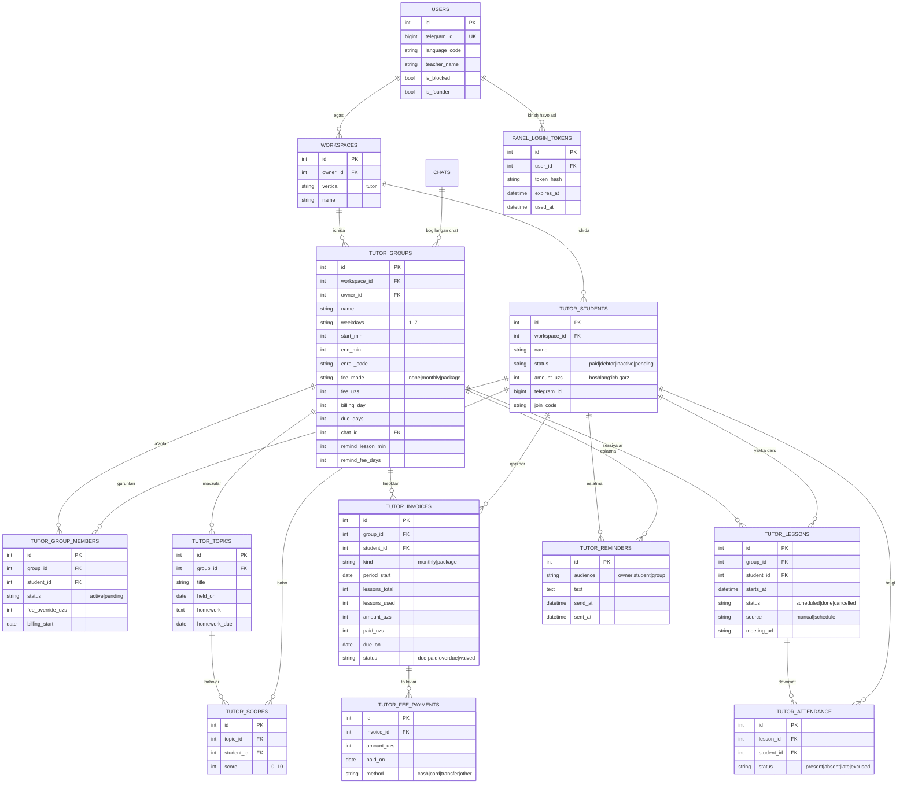

### 5.2. Hamjamiyat, tarif va tizim qismi

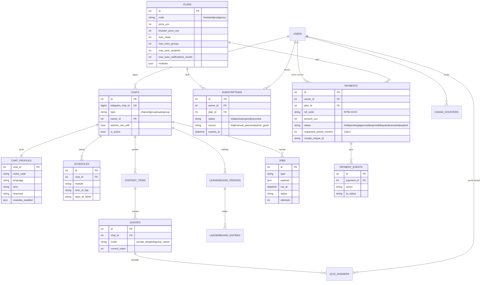

### 5.3. Qisqa izohlar

- **`users`** — har bir Telegram hisobi bitta qator; rollar bu yerda saqlanmaydi.
- **`workspaces`** — egasining kabineti, `(owner_id, vertical)` unikal. Kelajakdagi sohalar yangi `vertical` qiymati bilan qo‘shiladi.
- **`tutor_students`** — o‘qituvchi yaratgan karta; `telegram_id` keyin `join_` havolasi yoki guruhga so‘rov orqali bog‘lanadi. Bir hisob bir nechta o‘qituvchida o‘quvchi bo‘lishi mumkin.
- **`tutor_group_members`** — guruh–o‘quvchi bog‘i; `pending` = so‘rov, `active` = tasdiqlangan.
- **`tutor_lessons`** — sessiya: guruh slotidan (`source=schedule`) yoki qo‘lda/yakka (`manual`).
- **`tutor_invoices` / `tutor_fee_payments`** — kurs to‘lovi hisobi va unga qarshi qisman to‘lovlar (`paid_uzs ≤ amount_uzs`).
- **`tutor_notifications`** — `(kind, ref_id, target, target_id)` unikal; har bir eslatma bir marta ketishini kafolatlaydi. Turlari: `lesson, fee_due, fee_overdue, cancel, move, announce, manual, homework, attendance`.
- **`payments` + `payment_events`** — Ritm tarifi uchun to‘lov (o‘quvchi kurs to‘lovidan farqli). Voqealar jadvali faqat qo‘shiladi.
- **`jobs`** — umumiy navbat: kunlik post, kviz, admin post kvizi, reyting, eslatma, sinov hisobotlari, ta’lim xabarlari.
- **`audit_logs`, `system_state`, `ai_cache`, `usage_counters`, `usage_daily`, `notifications_log`, `tutor_widget_messages`** — yordamchi jadvallar.

---

## 6. Ish jarayonlari (workflow)

### 6.1. O‘quvchining guruhga qo‘shilishi (Bor)

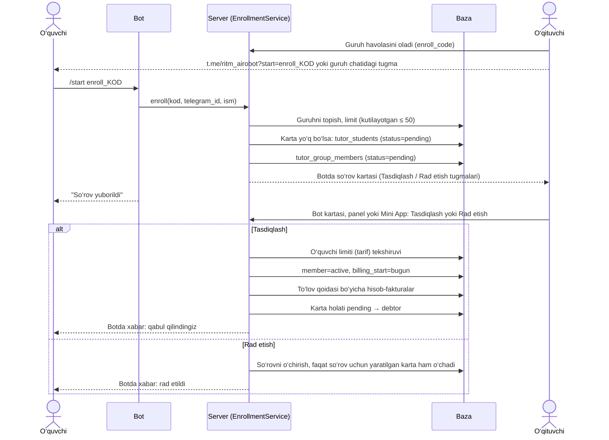

Muqobil yo‘l: o‘qituvchi kartani o‘zi yaratadi va shaxsiy `start=join_KOD` havolasini yuboradi — o‘quvchi bosganda karta uning Telegram hisobiga bog‘lanadi (tasdiq kerak emas).

### 6.2. Dars va davomat (Bor)

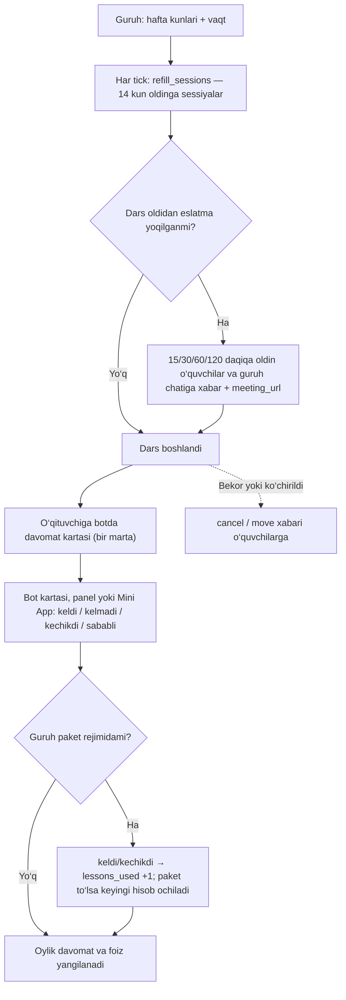

### 6.3. To‘lov qoidasi → hisob → eslatma → to‘lov qaydi (Bor)

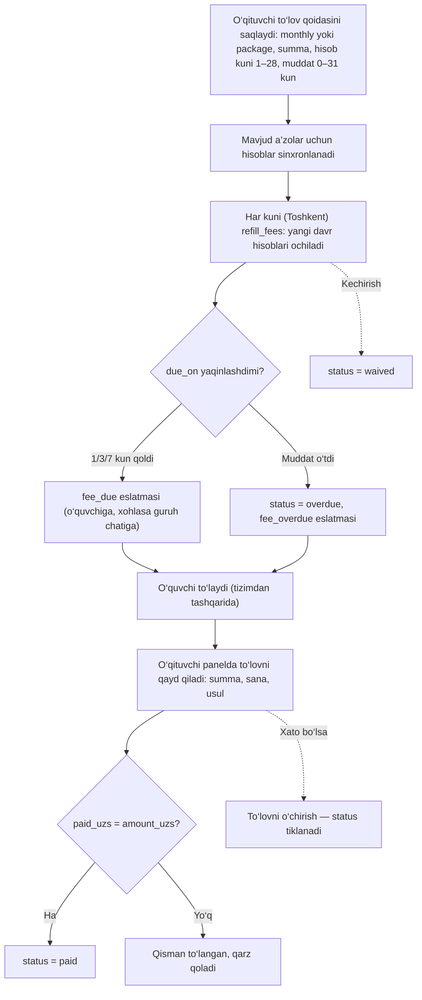

Tinch soatlar (22:00–08:00) va oylik xabar kvotasi barcha eslatmalarga qo‘llanadi.

### 6.4. Panelga kirish — magic link (Bor)

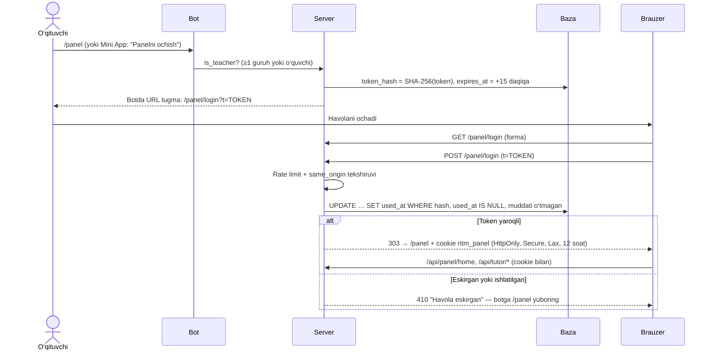

### 6.5. Ritm tarifini sotib olish (Bor)

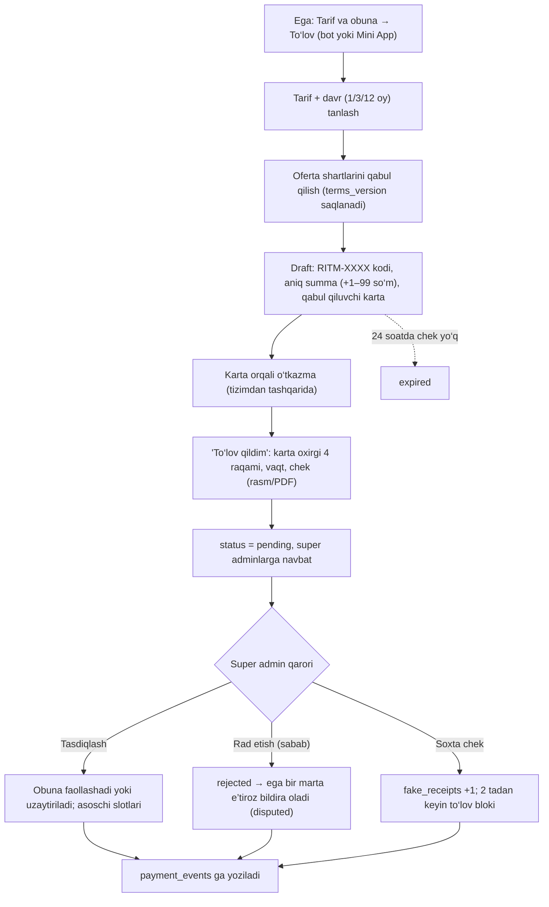

### 6.6. Rejada: darsdan keyin 1–5 baho (E fazasi)

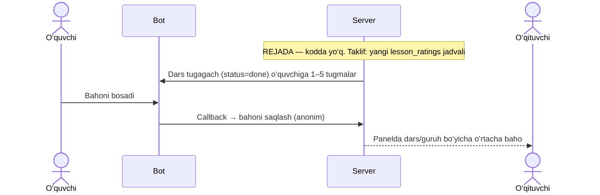

### 6.7. Rejada: uy vazifasini topshirish va baholash (F fazasi)

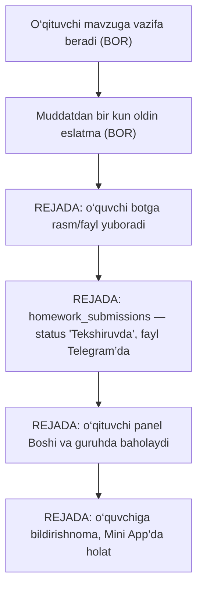

---

## 7. Arxitektura

### 7.1. Komponentlar

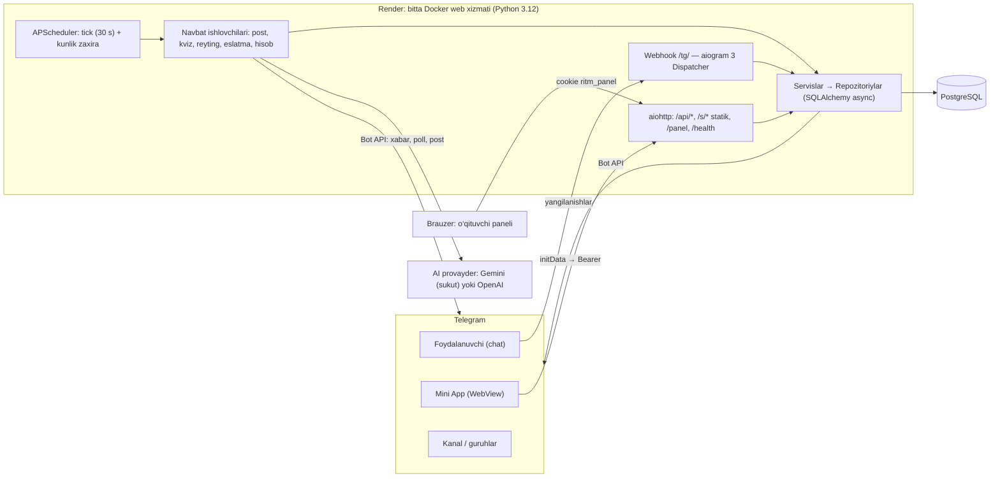

Qatlamlar qoidasi: **routerlar → servislar → repozitoriylar**; SQL so‘rovlar faqat repozitoriylarda. Foydalanuvchiga ko‘rinadigan matnlar `app/locales` va `i18n_*.js` da.

**Telegram rejimi (`TELEGRAM_MODE`):** `polling` (lokal Docker), `webhook` (Render, ishlab chiqarish), `off` (faqat Mini App va health, jadval ishlari yo‘q — staging).

**Baza:** kod oddiy PostgreSQL bilan ishlaydi (`DATABASE_URL`, `postgresql+asyncpg://`). Loyiha qaydlariga ko‘ra ishlab chiqarishda Neon Postgres ishlatiladi; repodagi `render.yaml` esa Render Postgres’ni e’lon qiladi — ikkalasining farqi Ochiq savollarda.

### 7.2. Deploy oqimi

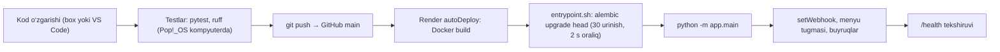

---

## 8. MVP chegarasi va Roadmap

### 8.1. Bajarilgan (MVP ichida)

| Bosqich | Mazmuni | Holat |
|---|---|---|
| 1–7 fazalar (hamjamiyat) | Onboarding, AI kunlik post, navbat, kvizlar, admin post kvizi, reyting, qo‘lda karta to‘lovi, asoschi narxi, sinov hisobotlari, zaxira, health, ogohlantirishlar | Bor |
| Ta’lim kabineti (migr. 0014–0034) | O‘quvchi, dars, guruh, ro‘yxatdan o‘tish va tasdiq, sessiyalar, davomat, kurs to‘lovlari, eslatmalar, mavzu/baho/vazifa matni, hisobotlar, o‘qituvchi ismi, vidjetlar, `meeting_url` | Bor |
| A. Rolni avtomatik yo‘naltirish | Boshdagi rol tugmalari olib tashlandi, `ritm.role` | Bor |
| B. O‘quvchi Mini App tuzilmasi | Bosh / Darslar / Profil | Bor |
| C. Panel qobig‘i va kirish | `/panel`, magic link (0035), cookie, alohida CSP | Bor |
| D. Panel sahifalari | Jadval, Guruhlar, O‘quvchilar, Davomat, To‘lovlar, Hisobotlar, Sozlamalar | Qisman — ba’zi amallar faqat Mini App’da (3-bo‘limga qarang) |
| “Ta’lim + Hamjamiyat” pozitsiyasi | Yangi matnlar, birinchi kirishda ikki yo‘l tanlovi, “Hamjamiyat” tabi | Bor (`afa8f9f`) |

### 8.2. Keyingi bosqichlar

| Bosqich | Mazmuni | Holat |
|---|---|---|
| D yakuni | Panelga qo‘shish: guruh/o‘quvchini o‘chirish, mavzu va vazifa, yakka dars, chat ulash, tarif sotib olish | Rejada |
| **E** | Darsdan keyin anonim 1–5 baho (`lesson_ratings`), panelda o‘rtacha | Rejada |
| **F** | Uy vazifasini botga yuborish, `homework_submissions`, baholash, holat | Rejada |
| O‘quvchi uchun eslatmalar | O‘quvchi Profilida eslatma turlarini yoqish/o‘chirish; to‘lov chekini botga yuborish | Rejada |
| G. Hamjamiyat va super admin panelda | `/panel/admin`, chatlar veb-panelda | Rejada |
| Boshqa yo‘nalishlar (vertical) | `workspaces.vertical` ga yangi qiymat, `vertical.js` da yangi paket (yorliqlar, tablar) | Rejada (arxitektura tayyor, kod yo‘q) |
| Avtomatik to‘lov | Click/Payme/Telegram Payments | Rejada (kodda faqat `manual_card`) |

---

## 9. Ochiq savollar

1. **Baza:** ishlab chiqarishda Neon ishlatiladi, `render.yaml` esa Render Postgres va `TELEGRAM_MODE=off` ni ko‘rsatadi. Blueprint’ni haqiqiy holatga moslash kerakmi?
2. **Rate limiter va FSM xotirada:** bitta instansiyada yetarli. Gorizontal masshtab yoki tez-tez qayta ishga tushish bo‘lsa, Redis/Key Value kerakmi?
3. **Free tarif va ta’lim:** Free’da kurs to‘lovini qayd qilib bo‘lmaydi va xabar kvotasi 0. Bu ataylabmi yoki o‘qituvchilar uchun alohida bepul daraja kerakmi?
4. **`agency` kodi “Ultra” nomi bilan** — kodni ham `ultra` ga o‘zgartirish kerakmi (migratsiya va to‘lov tarixi ta’siri)?
5. **E fazasi:** baho butunlay anonim bo‘ladimi yoki o‘qituvchi kim baho berganini ko‘radimi? Qaysi darslarga so‘raladi (faqat “keldi”/“kechikdi”)?
6. **F fazasi:** fayl faqat Telegram’da saqlanadimi (`file_id`) yoki nusxa kerakmi? Baholash 0–10 (mavjud `tutor_scores` kabi) yoki alohida shkala? Kechikib topshirishga ruxsat bormi?
7. **Ota-ona roli:** o‘quvchi kartasiga ikkinchi Telegram hisobi (ota-ona) bog‘lanadimi?
8. **Bir nechta o‘qituvchi bitta kabinetda** (o‘quv markaz): hozir kabinet = bitta egasi. Xodim/yordamchi roli kerakmi?
9. **O‘quvchi kurs to‘lovini tizimda to‘lashi** (chek yoki onlayn) — qachon va qaysi usulda?
10. **Panel uchun zaxira kirish** (Telegram Login Widget) kerakmi yoki magic link yetarlimi?
11. **Yangi vertical** — birinchi qaysi soha va unda “guruh/dars/to‘lov” atamalari qanday nomlanadi?
